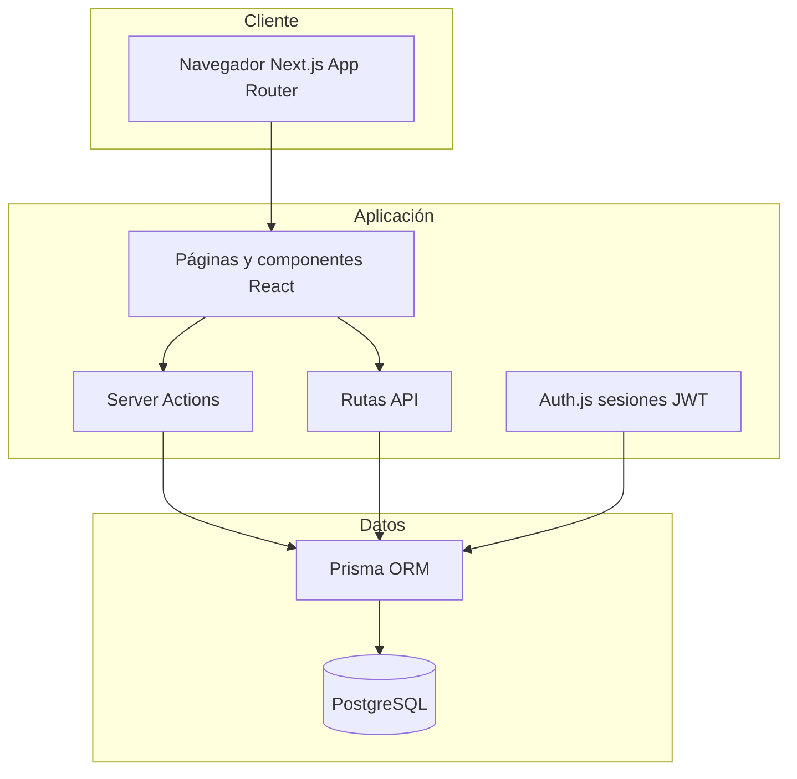

# Arquitectura de Bastion

Bastion es una plataforma educativa de ciberseguridad orientada a principiantes de habla hispana. Este documento describe la arquitectura técnica, flujos principales y decisiones de diseño.

## Visión general

## Stack tecnológico

| Capa | Tecnología | Rol |
|------|------------|-----|
| Frontend | Next.js 16 (App Router), React 19, Tailwind CSS 4 | UI responsive, modo oscuro, accesibilidad básica |
| Backend | Server Actions + Route Handlers | Mutaciones y APIs mínimas (registro, Auth.js) |
| Autenticación | Auth.js (NextAuth v5) credenciales | Cookies HttpOnly, sesión JWT, CSRF integrado en Auth.js |
| Validación | Zod | Entrada de registro, login y envío de cuestionarios |
| Datos | PostgreSQL + Prisma | Cursos, progreso, intentos de quiz, logros |
| Pruebas | Vitest (unidad), Playwright (e2e) | Gamificación, calificación de quizzes, flujo crítico |

## Modelo de dominio

- **User**: credenciales (hash bcrypt), XP y nivel calculado.
- **Course / Lesson / Quiz**: contenido pedagógico; cada curso tiene lecciones ordenadas y un cuestionario final.
- **Enrollment / LessonProgress / QuizAttempt**: progreso persistente por usuario.
- **Achievement / UserAchievement**: gamificación y bonificaciones de XP.

Los cursos se organizan por dificultad (`PRINCIPIANTE`, `INTERMEDIO`, `AVANZADO`).

## Autenticación y seguridad

1. **Registro** (`POST /api/auth/register`): validación Zod, hash bcrypt (cost 12), límite de tasa por IP (5 intentos / 15 min).
2. **Inicio de sesión**: Server Action con límite por correo (10 / 15 min) y Auth.js credentials.
3. **Sesión**: JWT en cookie HttpOnly; `secure` en producción.
4. **Rutas protegidas**: middleware sobre `/panel`, `/cursos`, `/perfil`.
5. **Cuestionarios**: las opciones correctas (`isCorrect`) no se envían al cliente antes del envío; la calificación ocurre en el servidor (`gradeQuiz`).

Variables sensibles solo en `.env` (plantilla en `.env.example`).

## Gamificación

- Fórmula de nivel: XP necesaria para nivel `n` = `(n - 1)² × 100`.
- XP por lección completada, quiz aprobado (≥ 70 %) y curso terminado.
- Logros desbloqueables (primera lección, primer quiz, curso completo, nivel 5, tres inscripciones).

## Flujos de usuario

1. **Landing** pública → registro / login.
2. **Catálogo** → detalle de curso → inscripción.
3. **Lección** → marcar completada → XP.
4. **Quiz** → envío → retroalimentación y XP si aprueba.
5. **Panel y perfil** → progreso, logros e historial.

## Despliegue local

- `docker-compose.yml` levanta PostgreSQL 16.
- Migraciones Prisma y `pnpm db:seed` cargan contenido real en español.
- La app escucha en el puerto 3000 por defecto.

## CI/CD

GitHub Actions ejecuta lint, typecheck, pruebas unitarias, build y e2e con servicio Postgres. Dependabot apunta actualizaciones a la rama `dev`.

## Extensiones futuras (fuera de alcance inicial)

- OAuth social, recuperación de contraseña por correo.
- Panel de administración de contenido.
- Rate limiting distribuido (Redis / Upstash).
- Internacionalización adicional más allá del español LATAM.
